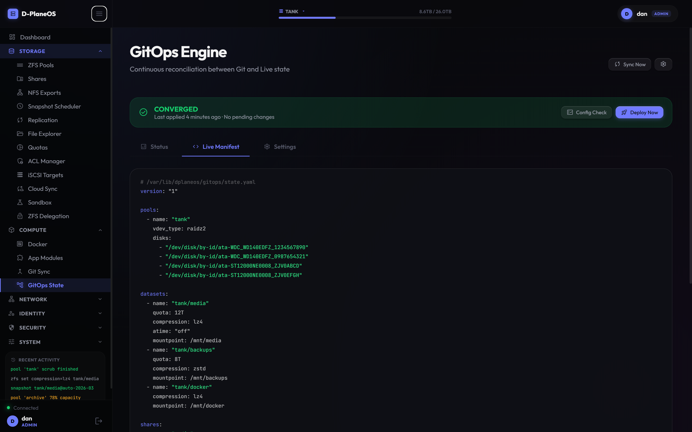

# DPlaneOS

A ZFS-first storage operating system for homelab and small-office NAS deployments. Single Go daemon, PostgreSQL state, React UI, NixOS appliance. Declarative from the OS down to the dataset.

[](https://github.com/4nonX/DPlaneOS/releases/latest)
[](https://github.com/4nonX/DPlaneOS/blob/main/LICENSE)
[](https://github.com/4nonX/DPlaneOS/blob/main/nixos/README.md)
[](https://github.com/4nonX/DPlaneOS/actions)

[](https://dplane.d-net.me/demo.html)

*Click the screenshot for an interactive tour of the UI.*

---

## Project status

Read this before you deploy anything.

DPlaneOS is built and maintained by one person (hi, [Dan](https://github.com/4nonX)). It runs in my own homelab on roughly 33 TB across 60+ services and has done so reliably for months, which is the entire production deployment base I can point to. If you need vendor support, a roadmap committee, or a phone number to call at 3am, this is not the project for you. Yet.

Feature maturity, honestly:

| Area | Status | Notes |
|------|--------|-------|
| ZFS pool / dataset / snapshot management | Stable | The core. Used daily. |
| SMB, NFS, iSCSI sharing | Stable | Samba + kernel NFS + LIO. |
| Container management (Docker, Compose) | Stable | Including ZFS-clone sandboxes. |
| Hot-swap detection and auto-import | Stable | udev + ZED, exercised regularly. |
| LDAP / Active Directory integration | Beta | Sign-in with directory accounts; membership in an Active Directory domain (domain users on SMB shares, resolved in `ls -l` and ACLs). Tested against OpenLDAP and a Samba domain controller, not against Windows Server. |
| OIDC / SSO (Authorization Code + PKCE) | Beta | Standard OpenID Connect; tested against a simulated provider (the whole flow), not against a particular product. |
| Licensing & Compliance Engine | Not in this repository | An optional, separate, closed program. Nothing here builds or tests it. |
| System updates with automatic return | Beta | Signed update files; the new version runs on trial and is removed again if the system is not healthy. Tested in VMs for every release; few real machines so far. |
| Live boot (ephemeral, no install needed) | Stable | Trial the software, manage pools, run containers from USB. Full daemon/UI in RAM. Persistence optional via USB. |
| GitOps reconciliation | Beta | Plan and apply from `state.yaml`, capture from the live system, drift detection, optional automatic apply of harmless commits. Destroying data needs an approval, always. Edge cases at the property-coverage frontier still surfacing. |
| Out-of-band hardware management (BMC) | Beta | Redfish (iLO 5+, iDRAC 9+), iLO 4 legacy REST, generic IPMI. TOFU TLS certificate pinning. Sensors, event log, power management. |
| Clusters, storage groups, third vote | Experimental | Corosync quorum, shared and replicated storage groups, failover; tested in VMs for every release, not yet under real load. |
| Shared-disk HA with disk reservations (SCSI-3) | Experimental | Automated test against shared iSCSI disks, for every release. Not validated on physical SAS shelves by the project: run the probe and the [takeover test](docs/reference/HA-HARDWARE-MATRIX.md) on yours. |
| NVMe-oF over TCP | Experimental | Functional, not yet stress-tested. |

If you're considering this for anything beyond a homelab, also read the [Threat Model](docs/reference/THREAT-MODEL.md) (13 scenarios, known gaps documented) and the [Non-ECC RAM Warning](docs/hardware/NON-ECC-WARNING.md).

Bug reports are welcome. So are contributors; the [CLA](docs/legal/CLA-INDIVIDUAL.md) is upfront about copyright assignment, which some people will not be comfortable with. Fair.

---

## How is this possible as a solo project

Reasonable question. The short answer: most of DPlaneOS isn't DPlaneOS.

**NixOS does the heavy lifting.** The OS, the bootloader, service supervision, the package set, reproducible builds, generation-based rollbacks, firewall, user management, kernel module loading, the whole declarative configuration model. None of that is my code. NixOS already solved it, better than I could in ten lifetimes. DPlaneOS is a NixOS module and a daemon that drives it.

**OpenZFS does the storage.** Pools, datasets, snapshots, send/receive, encryption, ARC tuning, scrub, resilver, integrity checking, all of it. The daemon runs `zfs` and `zpool` with allowlisted arguments and parses the output. That's it. The hard storage problems were solved by Sun, then Illumos, then OpenZFS, over twenty years.

**The system stack is well-trodden upstream software.** PostgreSQL for state, nginx for the edge, Corosync for cluster quorum (as in Proxmox VE), Samba for SMB, the kernel for NFS and LIO/iSCSI, Docker for containers, NUT for UPS, rclone for cloud sync, ZED for ZFS event delivery. Each of these has more engineering hours behind it than I will produce in my career.

**The Go dependency tree is deliberately small.** Eleven direct dependencies: `gorilla/mux`, `gorilla/websocket`, `pgx`, `goose` (migrations), `go-ldap`, `lego` (ACME), `creack/pty`, `google/uuid`, `golang.org/x/crypto`, `golang.org/x/sys`, `go-jose/v4` (OIDC JWS verification). All vendored. The daemon is not a wrapper around a large framework; it's standard library plus narrow, well-understood plumbing.

So what's actually new code?

**The seams.** About 80k lines of Go (plus 12k of tests) that tie the above together: some 490 HTTP routes mapping what the interface asks for to allowlisted commands, state in PostgreSQL with goose migrations, a reconciler that compares declared with observed state, an HMAC-chained audit log, ZED events over WebSocket, system updates that run on trial and return by themselves, storage groups that move between nodes with quorum, epochs and layered protection (watchdog, multihost, disk reservations, power fencing), and the exchange of configuration between nodes.

**The interface.** About 42k lines of React 19 / TypeScript: some fifty pages and their dialogs, one embedded terminal. Aimed at someone who would rather not memorise `zpool` flags or hand-edit a Samba config.

**The GitOps layer.** A declarative `state.yaml` schema and a bi-directional reconciler that lets you treat a Git repo as the source of truth for the *shape* of your storage: pools, dataset hierarchy and properties (quota, compression, atime, recordsize, encryption, mountpoint), shares, NFS exports, container stacks, users, replication relationships. You can apply changes from Git to the live system, or capture the live state back into Git. What it does *not* manage is the data plane itself: dataset contents, snapshots, and `zfs send` streams stay on ZFS's terms and are backed up out of band. The reconciler is also conservative in the places that matter: pool destruction is always BLOCKED, dataset destruction is BLOCKED whenever `zfs get used` is non-zero, and there's an `ignore_extraneous` flag for partial declarations. A `git push` cannot wipe data; only metadata and configuration. This is the part I'm proudest of and also the part most likely to have rough edges at the property-coverage frontier.

That's the honest accounting. DPlaneOS exists because NixOS, OpenZFS, PostgreSQL, and a dozen other projects exist. The work I did is the integration layer and the UX. Both are real work, neither is "building a storage OS from scratch," and pretending otherwise would be insulting to the upstream projects this whole thing rests on.

---

## Acknowledgements

DPlaneOS stands on the shoulders of decades of work by people I have never met. A non-exhaustive list of the projects this would not exist without:

**The foundation.** [NixOS](https://nixos.org) and [Nixpkgs](https://github.com/NixOS/nixpkgs) for the declarative OS model that makes the whole appliance approach feasible. [OpenZFS](https://openzfs.org) for the filesystem the project is named after and built around. [PostgreSQL](https://www.postgresql.org) for state that doesn't lose itself.

**The services.** [nginx](https://nginx.org), [Samba](https://www.samba.org), [Corosync](https://corosync.github.io/corosync/), [Docker](https://www.docker.com), the Linux kernel's NFS and LIO/iSCSI subsystems, [rclone](https://rclone.org), [smartmontools](https://www.smartmontools.org). Each one a project I have used for years and never had cause to regret picking.

**The libraries.** [gorilla/mux](https://github.com/gorilla/mux) and [gorilla/websocket](https://github.com/gorilla/websocket), [jackc/pgx](https://github.com/jackc/pgx), [go-ldap](https://github.com/go-ldap/ldap), [go-acme/lego](https://github.com/go-acme/lego), [creack/pty](https://github.com/creack/pty), [go-jose/v4](https://github.com/go-jose/go-jose). Plus the Go team's `golang.org/x/crypto` and friends.

**The frontend.** [React](https://react.dev), [TanStack Router and Query](https://tanstack.com), [Zustand](https://github.com/pmndrs/zustand), [xterm.js](https://xtermjs.org), [Vite](https://vitejs.dev). The [Outfit](https://github.com/Outfitio/Outfit-Fonts) and [JetBrains Mono](https://www.jetbrains.com/lp/mono/) typefaces, plus [Material Symbols](https://fonts.google.com/icons).

Full license inventory and attribution in [NOTICE.md](NOTICE.md).

---

## Getting Started

**Install to disk** (permanent):
- Download the [latest installer ISO](https://github.com/4nonX/D-PlaneOS/releases)
- Follow the [Installation Guide](docs/admin/INSTALLATION-GUIDE.md)
- Installation on a disk of its own, with system updates

**Try live boot** (no installation needed):
- Download the [latest live ISO](https://github.com/4nonX/D-PlaneOS/releases) (same releases, look for `-live` in filename)
- Flash to USB and boot
- Full D-PlaneOS in RAM, ephemeral state, auto-import existing ZFS pools
- See [Live Boot Quick Start](docs/admin/LIVE-BOOT-QUICKSTART.md)

---

## What it does

| Area | Capabilities |
|------|-------------|
| **Storage** | ZFS pools, datasets, snapshots, `zfs send` replication, native encryption, quotas, S.M.A.R.T., POSIX ACLs, file explorer with chunked uploads |
| **Hot-swap** | udev detects disk add/remove; daemon auto-imports FAULTED/UNAVAIL pools and suggests vdev replacements in the UI |
| **Sharing** | SMB (with Time Machine via `vfs_fruit`), NFS, iSCSI, NVMe-oF, configured from the UI |
| **Containers** | Docker, Compose stacks, ephemeral ZFS-clone sandboxes, updates with rollback, in-browser terminal. GPU devices are passed to containers (hardware transcoding with the drivers the container image brings). |
| **Network** | Interface config, bonding, VLANs, routing, DNS |
| **Identity** | Local users (each also a Unix, SMB and FTP account), LDAP sign-in, membership in an Active Directory domain (domain users on SMB shares, visible in `ls -l` and ACLs), OIDC SSO (Authorization Code + PKCE), TOTP 2FA, SCRAM-SHA-512, API tokens |
| **Security** | RBAC (4 built-in roles, 31 permissions, custom roles), HMAC audit chain, CSRF protection, firewall, TLS, allowlist-validated exec calls, govulncheck in CI |
| **Hardware** | BMC management via Redfish (iLO 5+, iDRAC 9+), iLO 4, or IPMI. TOFU TLS certificate pinning. Temperature, fan, power sensors. Power management and event log. |
| **Monitoring** | Prometheus/OpenMetrics at `/metrics`: ZFS pool health (4-level), dataset usage/quota, scrub progress, cluster quorum and storage groups, replication status, BMC sensors, build info |
| **HA** | Optional, off by default. Pair nodes, form a Corosync cluster, add a third vote (QDevice on a Raspberry Pi/VM, a corosync-only voter, another DPlaneOS system, or a third node), and put pools into storage groups that move between nodes with their shares, apps and a floating address. Shared storage (SAS/SATA shelf, SAN) or replicated ZFS; watchdog self-fencing, ZFS multihost, disk reservations (SCSI-3) and optional power fencing. |
| **System** | Dashboard, logs, UPS (NUT), hardware auto-tuning, cloud sync (rclone), HA node monitoring |
| **GitOps** | Git-sync repositories, plan and apply from `state.yaml`, capture, drift detection, optional automatic apply with a webhook. Manages structure (pools, dataset properties, shares, stacks, users, system settings), not data. Destructive operations on used datasets and pools are blocked by default. |

---

## Install

Boot the installer ISO. It handles everything.

```bash
# Write the ISO to USB (Linux/macOS)
dd if=dplaneos-v*.iso of=/dev/sdX bs=4M status=progress conv=fsync
```

1. Boot the target machine from USB (UEFI).
2. The installer starts by itself. Choose the system disk and set the administrator password.
3. DPlaneOS installs from the medium, without network access, and restarts.
4. Open `https://<address of the machine>/` (the certificate is self-signed until you set one) and sign in as `admin`.

**Download:** [Latest release](https://github.com/4nonX/DPlaneOS/releases/latest). `dplaneos-v*-installer-amd64.iso` (x86_64) or `...-arm64.iso` (aarch64 machines with UEFI firmware). The same medium resets a lost administrator password. For the third vote of a cluster there are separate, small witness images (Raspberry Pi SD card, x86 disk image); see [Choosing a third vote](docs/admin/THIRD-VOTE.md).

**Offline / air-gapped:** the ISO contains the complete system. No internet access is needed to install or to run it. Updates can be brought as files.

**Updates:** System › System Updates finds new releases, or takes an update file you upload. Update files are signed; a system only installs what is signed with the release key it was installed with.

**Cosign / provenance:** every ISO is signed with [cosign](https://github.com/sigstore/cosign) and accompanied by an SPDX SBOM. Verify with `cosign verify-blob --bundle dplaneos-v*.iso.bundle dplaneos-v*.iso`.

**Rebuilding from source:** `nix build .#iso`. See [nixos/README.md](nixos/README.md).

### Minimum hardware

- 64-bit CPU, x86_64 or aarch64, with UEFI firmware
- 8 GB RAM minimum, 16 GB recommended, more for large pools
- ECC RAM strongly recommended for ZFS; non-ECC is supported but read the [warning](docs/hardware/NON-ECC-WARNING.md) first
- One disk of 32 GB or more for the system, plus the disks you intend to pool
- Full compatibility list: [Hardware Compatibility](docs/hardware/HARDWARE-COMPATIBILITY.md)

---

## Architecture

The runtime is a single statically linked Go daemon (`dplaned`) behind nginx, with PostgreSQL for state. The daemon talks to ZFS, Docker and the system by running commands checked against an allowlist (no shell, no string interpolation). The frontend is a pre-built React 19 bundle served as static files.

```
Browser
  └── nginx :80/:443          the web interface (static files)
        └── proxy /api/ /ws/
              └── dplaned (Unix socket)
                    ├── PostgreSQL   /var/lib/dplaneos/pgsql/ (on this node)
                    ├── ZFS          zfs and zpool, through the allowlist
                    ├── Docker       socket
                    └── LDAP / AD / OIDC   optional
```

| Component | Detail |
|-----------|--------|
| Frontend | React 19 + TypeScript + Vite, pre-built, no Node.js at runtime |
| Backend | Go daemon; commands run with argument lists, never through a shell, and against an allowlist where arguments come from requests |
| Database | PostgreSQL 15+ (one per node) |
| Auth | SCRAM-SHA-512 (RFC 5802, 100k PBKDF2 iterations), bcrypt (web login over HTTPS), LDAP bind (directory accounts), OIDC Authorization Code + PKCE (SSO accounts), TOTP 2FA, AAL1/AAL2 session assurance levels, CSRF double-submit |
| ZFS events | ZED hook delivers pool fault, scrub, and resilver events in real time |
| BMC | Redfish (iLO 5+, iDRAC 9+), iLO 4 legacy REST, generic IPMI. TOFU TLS fingerprint pinning - no InsecureSkipVerify. |
| Observability | Prometheus/OpenMetrics at `/metrics`. ZFS, cluster, replication and BMC sensor metrics. govulncheck on every CI run. cosign-signed releases with SPDX SBOMs. |

Deeper reading: [Architecture](docs/reference/ARCHITECTURE.md), [Design Philosophy](docs/reference/PHILOSOPHY.md), [NixOS Rationale](docs/reference/NIXOS-RATIONALE.md).

---

## Key paths

On an installed system:

| Item | Path |
|------|------|
| State (database, settings, keys, certificates) | `/var/lib/dplaneos/` (on the `persist` partition) |
| Database | `/var/lib/dplaneos/pgsql/` |
| Samba configuration, written by the daemon | `/var/lib/dplaneos/smb-shares.conf` |
| Network configuration, written by the daemon | `/var/lib/dplaneos/network/` |
| The daemon's socket | `/run/dplaneos/dplaned.sock` |
| The system itself (read-only) | `/nix/store`, selected by the boot loader |

---

## Quick command reference

At the console or over SSH, as an administrator of the web interface:

```bash
# Services
systemctl status dplaned nginx postgresql
sudo systemctl restart dplaned
journalctl -u dplaned -f

# Does the daemon answer
curl --unix-socket /run/dplaneos/dplaned.sock http://localhost/health

# ZFS
zpool status
zpool import

# System version and updates
sudo dplaneos-update status
```

Locked out, no network, a system that does not start: [Recovery Guide](docs/admin/RECOVERY.md).

---

## Documentation

### Installation and operation

| Document | What it covers |
|----------|---------------|
| [Installation Guide](docs/admin/INSTALLATION-GUIDE.md) | Requirements, the installer, first steps, updates |
| [Administrator Guide](docs/admin/ADMIN-GUIDE.md) | Users, roles, permissions, storage, containers, LDAP/AD, security |
| [Git-Driven NAS](docs/admin/GITOPS-DRIVEN-NAS.md) | Operating DPlaneOS from `state.yaml`: bootstrap, automatic apply, rollback, PR workflow, clusters |
| [Backup and Replication](docs/admin/BACKUP-REPLICATION.md) | Snapshots, ZFS send/receive, cloud sync, cold tier, rsync, DB backup, recovery |
| [High Availability](docs/admin/HIGH-AVAILABILITY.md) | HA is optional and off by default. Clusters, the third vote (see also [Choosing a third vote](docs/admin/THIRD-VOTE.md)), storage groups (shared or replicated), protection layers, planned moves and failover |
| [Integration Guide](docs/admin/INTEGRATION-GUIDE.md) | Prometheus, Active Directory membership, SMB and failover, iSCSI and NVMe-oF clients and failover, GitOps in CI, GPU passthrough |
| [System Updates](docs/admin/OTA-UPDATES.md) | Signed update files, the trial start, automatic and manual return, updating without internet access |
| [Optional Protocols](docs/admin/OPTIONAL-PROTOCOLS.md) | iSCSI, NVMe-oF, FTP/FTPS, S3 |
| [Alerts and Authentication](docs/admin/ALERTS.md) | SMTP, webhook, Telegram alerting, TOTP 2FA setup and backup codes |
| [Troubleshooting](docs/admin/TROUBLESHOOTING.md) | Build failures, ZFS issues, DB init race, Docker behind proxy, ZED setup |
| [Recovery Guide](docs/admin/RECOVERY.md) | Lost administrator password, a system that does not start, no network, ZFS recovery, the system disk is gone |
| [Design Documents](docs/design/README.md) | Proposed architecture changes and decision records: local-first node state, storage groups, quorum, fleet overlay, GitOps defaults |

### Reference

| Document | What it covers |
|----------|---------------|
| [Features](FEATURES.md) | Complete feature list by category |
| [Pitch](PITCH.md) | Git as control plane: the enterprise and fleet case |
| [Design Philosophy](docs/reference/PHILOSOPHY.md) | Four core principles, design decisions, tradeoffs |
| [Architecture](docs/reference/ARCHITECTURE.md) | Three-layer model, persistence, single-node and HA architecture |
| [GitOps Reference](docs/reference/GITOPS-REFERENCE.md) | `state.yaml` format, reconciliation engine, drift detection, Capture workflow |
| [Changelog](docs/reference/CHANGELOG.md) | Full version history |
| [Port Reference](docs/reference/PORT-REFERENCE.md) | Every port the system listens on, its service, interface binding, and safe ranges for Docker containers |
| [Error Reference](docs/reference/ERROR-REFERENCE.md) | Every HTTP error code the API returns, with cause and fix |
| [NixOS Rationale](docs/reference/NIXOS-RATIONALE.md) | Why DPlaneOS is NixOS-exclusive |
| [Porting Guide](docs/reference/PORTING-GUIDE.md) | Forking for other Linux distributions: what it takes, what you lose |
| [Limits, and What Has Been Tested](docs/reference/SHOWSTOPPER-MITIGATION-GUIDE.md) | What every release is tested with, where the limits are, how to trust the binaries |
| [Threat Model](docs/reference/THREAT-MODEL.md) | Security architecture, 13 threat scenarios, mitigations, residual risks, known gaps |
| [Dependencies](docs/reference/DEPENDENCIES.md) | Bundled Go and frontend deps, system requirements, build instructions |

### Hardware

| Document | What it covers |
|----------|---------------|
| [Hardware Compatibility](docs/hardware/HARDWARE-COMPATIBILITY.md) | CPUs, RAM, disk types, network, RAID controllers, auto-tuning |
| [Non-ECC RAM Warning](docs/hardware/NON-ECC-WARNING.md) | Why ZFS plus non-ECC is risky, probability analysis, mitigations |

### NixOS

| Document | What it covers |
|----------|---------------|
| [The NixOS side](nixos/README.md) | How an installed system is put together, building the images, running the tests, the files |

### Development

| Document | What it covers |
|----------|---------------|
| [Contributing](CONTRIBUTING.md) | Dev setup, project structure, coding conventions, security requirements for PRs |
| [Codebase Diagram](docs/development/CODEBASE-DIAGRAM.md) | Mermaid diagrams: system overview, daemon internals, request lifecycle, disk events, auth flow |
| [Design System](app-react/.stitch/DESIGN.md) | Frontend design tokens, spacing grid, component patterns, anti-pattern list |

### Legal

| Document | What it covers |
|----------|---------------|
| [License](LICENSE) | GNU Affero General Public License v3.0 |
| [Notice](NOTICE.md) | Third-party components, attributions, and licenses |
| [Security Policy](SECURITY.md) | Vulnerability reporting, safe harbour, supported versions |
| [Individual CLA](docs/legal/CLA-INDIVIDUAL.md) | Contributor license agreement for individuals |
| [Entity CLA](docs/legal/CLA-ENTITY.md) | Contributor license agreement for organisations |

---

## License

DPlaneOS is licensed under the [GNU Affero General Public License v3.0](https://www.gnu.org/licenses/agpl-3.0.html).

If you run a modified version of DPlaneOS and let others interact with it over a network, AGPL § 13 requires that you offer them the Corresponding Source. The unmodified source is at [github.com/4nonX/DPlaneOS](https://github.com/4nonX/DPlaneOS); if you have modified it, you must make your modifications available to your users on equivalent terms.

Third-party components and their licenses are listed in [NOTICE.md](NOTICE.md).
