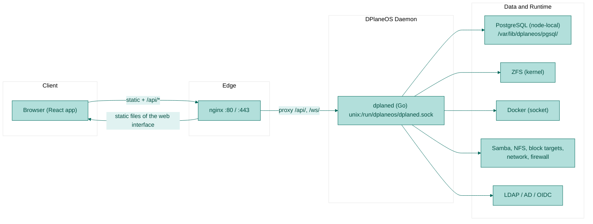
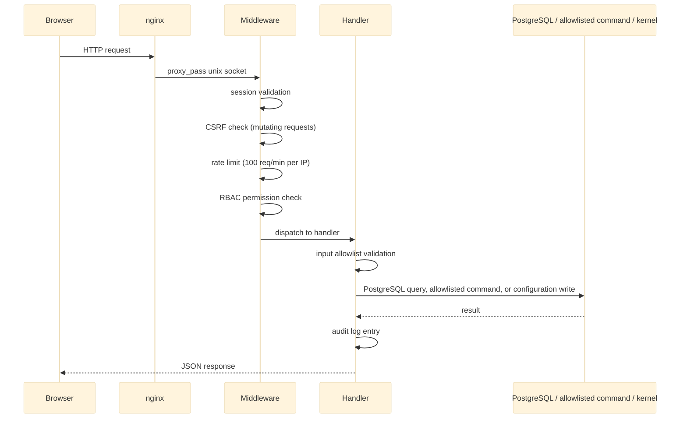
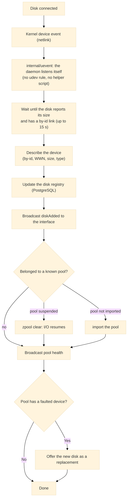
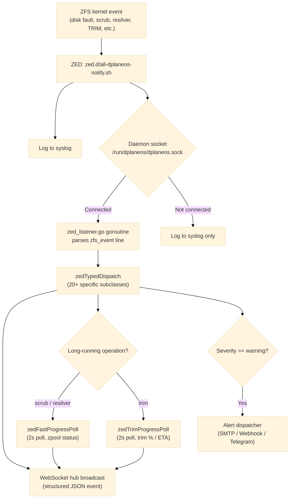
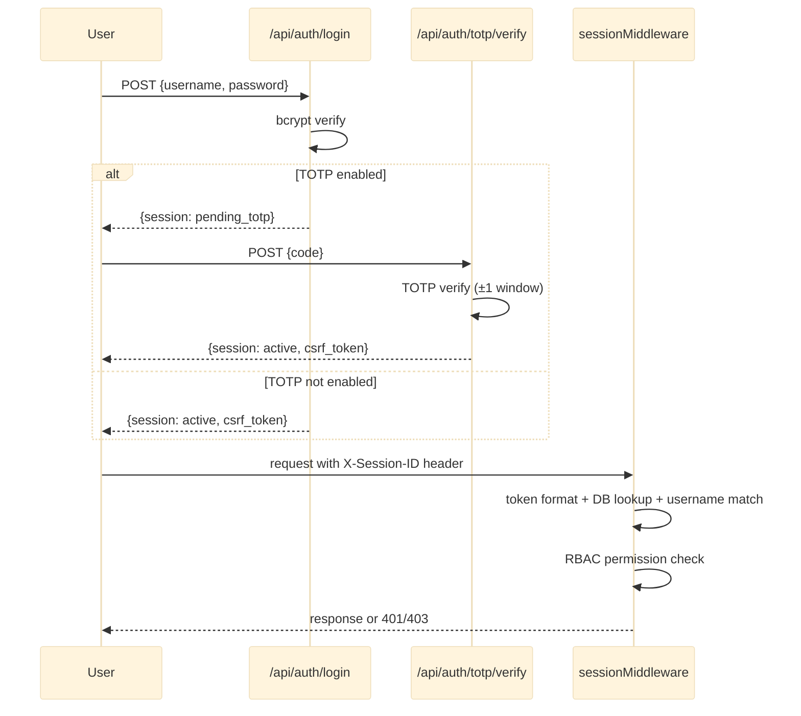

# DPlaneOS - Architecture Diagrams

Visual overview of the codebase. Render in any Mermaid-compatible viewer (GitHub, VS Code with Mermaid extension, or [mermaid.live](https://mermaid.live)).

---

## System Overview



---

## Daemon Internal Structure (Go)

```mermaid
%%{init: {'theme':'base', 'themeVariables': { 'primaryColor':'#b2dfdb', 'primaryTextColor':'#004d40', 'primaryBorderColor':'#00695c', 'lineColor':'#00695c', 'secondaryColor':'#e0f2f1' }}}%%
flowchart TB
    subgraph cmd["cmd/"]
        main["dplaned/main.go - flags, database, router, background loops"]
    end

    subgraph api["internal/ - the API"]
        handlers["handlers/ - one file per feature of the interface"]
        middleware["middleware/ - permissions, second factor"]
        security["security/ - sessions, RBAC, command allowlist, client address"]
        audit["audit/ - buffered log, HMAC chain"]
        jobs["jobs/ - long-running operations"]
        websocket["websocket/ - live events for the interface"]
    end

    subgraph storage["internal/ - storage"]
        libzfs["libzfs/ - ZFS operations (zfs and zpool commands)"]
        zfs_pkg["zfs/ - ZED listener, pool heartbeat, status parsing"]
        storageops["storageops/ - one storage operation at a time per pool"]
        hardware["hardware/ - SMART, enclosures, GPUs"]
        uevent["uevent/ - kernel device events (disks added and removed)"]
        iscsit["iscsit/ - iSCSI targets (LIO)"]
        nvmet["nvmet/ - NVMe-oF exports"]
        smbconf["smbconf/ - Samba configuration"]
    end

    subgraph system["internal/ - system"]
        nixwriter["nixwriter/ - system settings (state file)"]
        sysapply["sysapply/ - applies settings: host name, time, firewall, SSH"]
        netconf["netconf/ - network configuration (systemd-networkd)"]
        netlinkx["netlinkx/ - netlink (addresses, links)"]
        cmdutil["cmdutil/ - runs programs through the allowlist"]
        database["database/ - migrations (goose)"]
        secrets["secrets/ - encryption of stored secrets"]
    end

    subgraph cluster["internal/ - GitOps and clusters"]
        gitops["gitops/ - state.yaml parser, plan, apply, drift"]
        configstore["configstore/ - configuration exchange between nodes"]
        quorum["quorum/ - corosync membership and votes"]
        groups["groups/ - storage groups: ownership, moves, failover, replication"]
        diskres["diskres/ + scsipr/ - disk reservations (SCSI-3)"]
        ha["ha/ - watchdog, power fencing"]
    end

    main --> handlers
    main --> groups
    main --> gitops
    handlers --> middleware
    handlers --> security
    handlers --> audit
    handlers --> jobs
    handlers --> libzfs
    handlers --> iscsit
    handlers --> nvmet
    handlers --> smbconf
    handlers --> nixwriter
    handlers --> netconf
    handlers --> gitops
    handlers --> groups
    libzfs --> cmdutil
    nixwriter --> sysapply
    gitops --> libzfs
    gitops --> netconf
    groups --> quorum
    groups --> configstore
    groups --> diskres
    groups --> iscsit
    groups --> nvmet
    groups --> ha
    cmdutil --> security
```



---

## Request Lifecycle



---

## Disk Event Flow (Hot-Swap)



---

## ZED Hook Flow



---

## Authentication Flow

### Local / LDAP Login



### OIDC SSO Login (Authorization Code + PKCE)

```mermaid
%%{init: {'theme':'base'}}%%
sequenceDiagram
    participant B as Browser (SPA)
    participant D as dplaned
    participant I as IdP

    B->>D: GET /api/auth/oidc/start
    D->>D: generate state, nonce, PKCE verifier; store in oidc_state
    D-->>B: 302 → IdP authorization endpoint
    B->>I: GET /authorize?code_challenge=S256...
    I-->>B: 302 → /api/auth/oidc/callback?code=...&state=...
    B->>D: GET /api/auth/oidc/callback
    D->>D: DELETE oidc_state WHERE state=? (atomic, replay-safe)
    D->>I: POST /token {code, code_verifier, ...}
    I-->>D: {id_token, access_token}
    D->>D: verify ID token (sig, iss, aud, nonce, exp)
    D->>D: resolve or provision user
    D->>D: mint session; store in oidc_handoff (2-min TTL)
    D-->>B: 302 → /login?oidc_handoff=<code>
    B->>D: POST /api/auth/oidc/exchange {handoff_code}
    D->>D: DELETE oidc_handoff WHERE code=? RETURNING session_id
    D-->>B: {session_id, username, expires_at}
    B->>B: storeSession(); validateSession(); navigate to /
```

